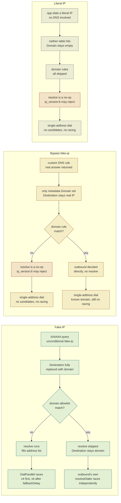

# Fake-IP routing pipeline

Single owner of: how a connection's `Destination` field moves between IP and domain form across DNS resolution (`dns.go`) and route matching (`route.go`), and why that movement — not "fake-ip vs not" — is what actually decides whether a connection gets IPv4/IPv6 Happy Eyeballs racing at dial time.

## Interface / Schema / Format

Three traffic shapes reach `route.matchRule` and are handled differently. All three share the same `route.rules` list — a single ordered, first-match-wins loop (`sing-box route/route.go:439`) — but differ in whether `metadata.Destination` is IP or domain form when the loop starts, and whether `action: resolve` (`route.go:188`) is a no-op for them.

Only the two Fake-IP terminal nodes (`F5a`, `F5b`) ever reach real Happy Eyeballs racing, because only they still carry `Destination` in domain form at dial time. Every other terminal is a single pre-determined address — there is nothing to race between.

| Stage | Condition checked | Source location |
| --- | --- | --- |
| First DNS resolution (client-facing) | `query_type` A/AAAA, no domain guard → unconditional fake-ip | `sing-box dns/router.go:263` (`Exchange`, `allowFakeIP=true`) |
| Fake-ip placeholder pool | `inet4_range 198.18.0.0/15`, `inet6_range fc00::/18` | `dns.go:47-52` |
| Reverse-mapping table write | Only non-fakeip answers inside `Exchange` are recorded | `sing-box dns/router.go:312-322` |
| Route entry mapping | Is `Destination` inside the fake-ip store? | `sing-box route/route.go:411-424` |
| Reverse-mapping table read | Only tried when `metadata.Domain == ""` | `sing-box route/route.go:426-431` |
| Rule matching order | `for range r.rules`, strict first-match-wins | `sing-box route/route.go:439-444` |
| `action: resolve` | Only runs if `metadata.Destination.IsDomain()` | `sing-box route/route.go:761-771` |
| Second resolution (`Lookup`) | `allowFakeIP=false` → fake-ip rule is skipped | `sing-box dns/router.go:377`, `154` |
| `ip_version:6` reject rule | Only matches `Destination.IsIP() && IsIPv6()` | `sing-box route/rule/rule_item_ipversion.go:17-20` |
| Dial entry branch | `len(DestinationAddresses) > 0 \|\| Destination.IsIP()` | `sing-box route/conn.go:100-104` |
| Happy Eyeballs racing | Split by address family, dial primary immediately, add fallback after `fallbackDelay` | `sing-box common/dialer/default_parallel_network.go:47-127` |
| Outbound's own resolution | Triggers when `Destination` is still domain form and the address list is empty | `sing-box common/dialer/resolve.go:94-112` |

(`sing-box` here means the vendored `github.com/sagernet/sing-box` source, version pinned in `go.mod`; the rest are this project's own files under `internal/proxy/config/module/`.)

## Racing runs client-side, and only for `direct`

`DialParallelNetwork` (`sing-box common/dialer/default_parallel_network.go:47`) is dispatched by a type assertion in `route/conn.go:100-101` against whichever outbound the rule selected (`route/route.go:158`, `selectedOutbound`). Across the whole vendored source, exactly one outbound implements `dialer.ParallelNetworkDialer`: `direct` (`protocol/direct/outbound.go:32`). VLESS/Trojan/Shadowsocks outbounds' `DialContext` takes a single `destination` and hands it straight into the wire protocol for the remote proxy server to resolve and dial (`protocol/vless/outbound.go:145-164`) — they never see `metadata.DestinationAddresses`, so nothing about racing is client-controllable once a connection leaves through a domain-passthrough proxy outbound.

- **Racing happens locally** (this device, inside the sing-box process) only for connections dialed by `direct` — both the route-level `action:resolve` path (`route/conn.go:100`) and `direct`'s own `RemoteIsDomain:true` resolveDialer wrapping (`protocol/direct/outbound.go:53-58`, domain-form `Destination` handed straight to `DialContext` — F5b above) end up in the same `DialParallelNetwork` call.
- **For domain-passthrough proxy traffic**, whether the real target address gets raced at all is entirely up to the remote proxy server's own software — invisible and uncontrollable from this config.
- **Current caveat**: racing only happens when both an IPv4 and an IPv6 candidate exist (`default_parallel_network.go:64-66` — otherwise falls back to `DialSerialNetwork`, one address at a time). Since `dns.strategy` is `ipv4_only` on macOS, AAAA is never queried, so `addresses6` is always empty — the v4/v6 race described in F5a/F5b never actually fires on macOS today. Dormant, not dead: iOS's `prefer_ipv4` still queries AAAA, so it can fire there.

## Rationale

The `ip_version:6 reject` rule (`route.go:198`, applied on both macOS and iOS as of this section) is a blunt filter: it only ever looks at whether `Destination` is currently an IP. That's an accurate proxy for "we know nothing about this connection" for literal-IP traffic, but it's the wrong proxy for bypass-fake-ip traffic — sing-box's reverse-mapping feature was designed only to let domain rules match literal-IP flows; it never rewrites `Destination`, so a bypass-fake-ip domain that resolves to AAAA-only and isn't caught by an earlier domain rule gets rejected exactly like a truly-unknown literal IP, even though the route engine knows its domain the whole time.

There's no declarative way to fix this inside sing-box's rule DSL (no "domain is unset" match exists). The practical invariant instead:

> Any domain configured to bypass fake-ip (in `profile.json`) must have an explicit direct-routing domain rule ahead of `ip_version:6 reject` in `route.go`. Without one, a domain that happens to resolve AAAA-only will be silently killed.

## IPv6 policy

**Current state**: DNS-sourced v6 is closed; literal-IP-sourced v6 has no special rule and flows through the same direct/proxy decision chain as v4.

- **DNS module**: `dns.strategy` is `ipv4_only` on macOS (`dns.go`; iOS keeps `prefer_ipv4` — see below). Per `sing-box dns/client.go:335-339`, `ipv4_only` means AAAA is *never queried*, on either the client-facing first resolution or the `resolve`-triggered second one — no v6 candidate can enter `DestinationAddresses` this way, full stop.
- **Literal IP an app obtained out-of-band** (its own API/CDN discovery, bypassing local DNS — confirmed to be how Soul's client behaves): no dedicated rule. It falls through to whatever `directDomainRuleSets` / `proxyIPRuleSets` / `geoip-cn` / ASN / `final` would have decided for the equivalent v4 traffic, and succeeds or fails on its own — see "why no reject rule" below.
- **Platform asymmetry is intentional**: iOS forces `dns.strategy` to `prefer_ipv4` in `applyPlatformCompat` (`compat.go`), not `ipv4_only`, because some Chinese cellular carriers run IPv6-only (DS-Lite/NAT64) with no real IPv4 path — forcing `ipv4_only` there would break DNS resolution entirely on those networks. macOS has no such carve-out; its tested network (home WiFi) is dual-stack-with-dead-v6, not v6-only, so cutting AAAA costs nothing there.

**Why no reject rule for literal v6** (history — this took three iterations to get right, worth keeping so it isn't relitigated from scratch):

1. **First version**: an unconditional `{"ip_version":6, "action":"reject"}`, on the assumption that a literal-v6 dial to an unreachable address would hang for the OS's default TCP timeout (30–75s), and that fast-failing it would let the app's own candidate-IP fallback (e.g. Soul's) recover quickly.
2. **Testing revealed a different bug entirely**: the fast-fail theory was never actually exercised, because a much earlier rule — added to let literal connections to AliDNS's own resolver IPs (`223.5.5.5`, `223.6.6.6`) bypass the tunnel and avoid a DNS-bootstrap loop — also carried `"2400:3200::/32"`. In IPv4 `/32` is a single exact address (matching the other two entries' intent); in IPv6 it is *not* — it leaves 96 bits open, covering the entirety of an allocation the size of Alibaba Cloud's. Sitting *before* the reject rule in the list, this caught any literal-v6 destination in that block (Soul's Alibaba-Cloud-hosted server included) and sent it straight to `direct`, bypassing `resolve`, `proxyIPRuleSets`, and the reject rule entirely. Found from an actual SFI connection log (`outbound/direct[direct]: ... dial en0 ... no route to host` — an immediate OS-level routing failure, not a timeout, not a rejection), not from reasoning about the rule chain. Fixed by dropping the `2400:3200::/32` entry (`dns.go`'s `local_dns` only ever dials AliDNS over IPv4 UDP — nothing in this config needs an IPv6 route to AliDNS, so there was no narrower CIDR to substitute; it was dead weight with a live side effect). **This fix stands regardless of what happens with the reject rule below** — it's a plain bug, not a policy tradeoff.
3. **Fixing that leak exposed the real flaw in the unconditional reject**: once literal-v6 traffic stopped being misrouted to `direct` by the CIDR bug, it correctly started reaching the reject rule instead — and broke cellular, which had been working. Measurement: this device's WiFi has no real v6 route (`curl -6` fails locally in ~6ms — confirmed by timing a local literal-v6 dial against a real proxied v4 request that took 860ms round-trip to an actual remote server); this device's cellular does have real v6 (content loaded over it before the CIDR leak was fixed, i.e. a real `direct`-via-bug dial over cellular actually succeeded end-to-end). A `network_type:wifi`-scoped version of the reject rule (`sing-box route/rule/rule_item_network_type.go`, reads the current default interface's type at match time) was tried to fix this without reopening the WiFi symptom, then reverted — the mechanism is real but untested on SFI's iOS platform integration, and re-deciding whether local network state even matters turned out to be the more useful next step (below).
4. **The actual resolution**: knowing "does this connection's eventual path have real v6" requires knowing two independently-unknowable-in-advance facts — this device's *local* network v6 (for `direct`-bound traffic) and, separately, the *remote proxy node's* v6 (for `proxy`-bound traffic, since a literal IP handed to a VLESS/Trojan outbound gets dialed by the remote server using its own network stack, not this device's). No static rule can know either in advance. But the WiFi `no route to host` log line already answered the question the whole reject rule existed to protect against: a `direct` dial on a network with no real v6 route fails at the OS level in milliseconds, not a 30–75s hang — there was never a hang to prevent. So the reject rule was removed rather than re-scoped again: literal-v6 traffic now goes through the exact same `direct`/`proxy` decision as v4, and whichever way it resolves, succeeds or fails at whatever speed the real network/OS produces. If a genuine multi-second hang (not a fast failure) is ever observed for literal-v6 traffic on some future network, that's the signal this assumption doesn't hold everywhere and needs revisiting — not a preemptive guess.

**How to test whether a route rule is actually firing** (used throughout this investigation, reusable for future rules): compare timing, not just log presence/absence. `curl -6 --connect-timeout N -w '%{time_connect} %{time_appconnect} %{time_total}'` against a literal address that should be rejected/direct vs. one that should genuinely proxy out. A few milliseconds total with no `time_appconnect` means the "connection" never left the local TUN stack (rejected, or hit a route with no real path); hundreds of milliseconds with a completed TLS handshake and real response headers means it actually reached the internet. TUN mode always completes the client-facing TCP handshake locally regardless of the eventual routing decision, so "curl says Connected" alone proves nothing — only the timing and the presence of a genuine remote response do.

## Related

No `docs/architecture/` exists yet for this project — this is currently the only design doc, standing on its own.

A standalone visual version of the diagram above (colored lanes, hover-free static page, open directly in a browser) lives at [`fake-ip-routing.html`](fake-ip-routing.html).

---

~110 lines. Split by sub-topic and register the split in [the index](README.md) if this grows past ~200.
